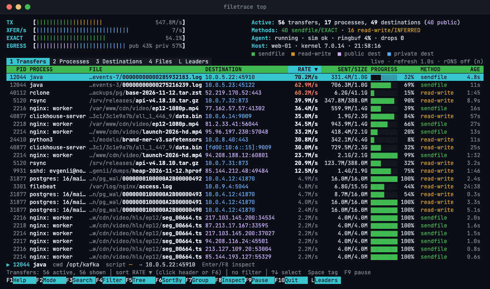

# Filetrace

Filetrace shows which files a machine sends over the network, which process
sends them, and where they go. It reads this from the kernel with eBPF, so no
application has to be changed.



`sudo filetrace top` is the live view above, recorded on simulated traffic:
the transfers in progress, the same traffic by process, destination and file,
and the files sent most over a window of time. The other commands print
lists:

```text
$ sudo filetrace files
FILE                PROCESS  DESTINATION     BYTES  METHOD      CONFIDENCE  SCRIPT
/var/www/video.mp4  nginx    198.51.100.4  1.20 GB  sendfile    EXACT       -
/data/users.csv     python3  192.0.2.10    85.2 MB  read-write  INFERRED    /srv/shop/export.py
/data/invoice.pdf   php-fpm  203.0.113.25  2.10 MB  read-write  INFERRED    /srv/blog/index.php
```

Start from a file to see who sends it and to whom, or from an address or a
process to see the files sent to it or by it. Every answer says how sure it
is: `EXACT` means the kernel moved the file to the socket itself (`sendfile`),
and `INFERRED` means a thread read the file and then sent on the socket.

For an interpreter, `SCRIPT` names the program it runs: the script of a
Python, PHP, Node.js, Ruby, Perl, Lua or shell process, and for PHP-FPM and
mod_php the script of the request that sent the file. Each process is also
recorded with its command line and working directory.

The agent can also publish what it sees as Prometheus metrics, over OTLP to
an OpenTelemetry collector, and through a gRPC API.

Collection needs Linux 6.1 or later, on x86-64 or arm64. On macOS the command
installs and reports diagnostics, and collects nothing.

The documentation is at <https://filetrace.eorlov.org>.

## Install

```sh
curl -fsSL https://filetrace.eorlov.org/install.sh | sudo sh
```

On Linux the installer sets up the apt, dnf, yum, zypper or apk repository
that fits the system and installs the `filetrace` package, so upgrades arrive
with the system's own. Without one of those package managers it unpacks the
release archive under `/usr/local`. It then starts `filetrace-agent`, the
service that collects; `filetrace` is the command that queries it. Append
`-s -- --help` to `sh` for the options: a version, the `lts` channel,
`--no-start`, `--uninstall`.

Homebrew, on macOS 15 or later and on Linux, installs the two programs
without a service:

```sh
brew install orlovevgeny/filetrace/filetrace
```

For anything else, a [release](https://github.com/OrlovEvgeny/filetrace/releases)
has the archives.

To check that the machine can be monitored:

```sh
sudo filetrace doctor
```

## Examples

The agent runs as root, so the commands that query it need `sudo`.

```sh
sudo filetrace top                             # live screen: transfers, processes, destinations, files
sudo filetrace top --leaders --window 24h      # the files sent most over the last day
sudo filetrace watch                           # live view of the transfers in progress
sudo filetrace files                           # files sent over the network
sudo filetrace files --remote 203.0.113.25     # files sent to one address
sudo filetrace files --script '/srv/shop/*'    # files sent by the scripts under one directory
sudo filetrace inspect file /data/report.pdf   # who sent a file, and to whom
sudo filetrace inspect process 1245            # what a process is sending
sudo filetrace processes                       # outbound rate and files sent per process
sudo filetrace events --type file_transfer --since 5m   # transfers of the last five minutes
sudo filetrace files --json                    # the same list as JSON
```

`filetrace help <command>` lists a command's options.
